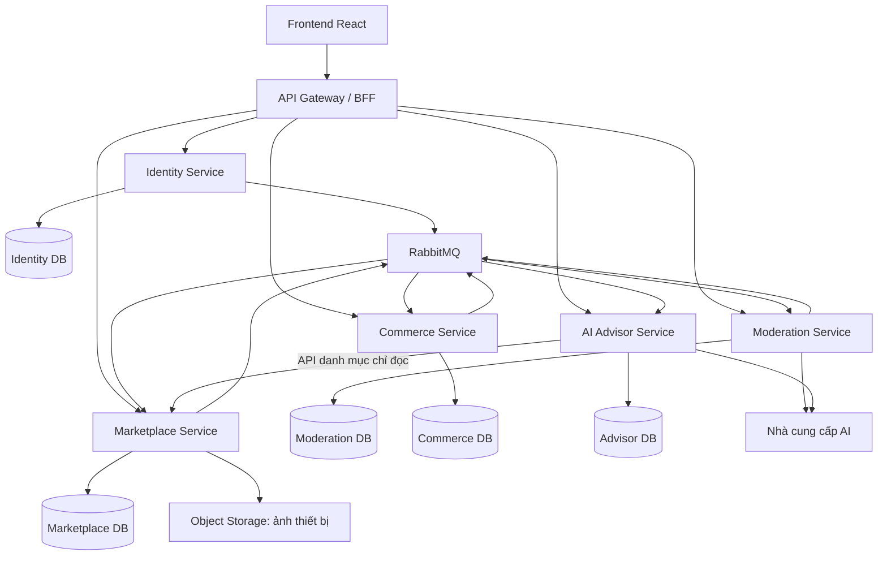

# CameraHub — Bản thiết kế cấu trúc microservice

Thiết kế ban đầu: 25/10/2026. Đã triển khai mã nguồn ngày 26/10/2026: xem
[cấu trúc lớp và hướng dẫn chạy](../microservices/README.md). Bản chạy hiện tại dùng
Spring Data JPA/Hibernate, Lombok, MapStruct, JWT RSA và HTTP outbox/inbox.
RabbitMQ, Redis và OIDC authorization server đầy đủ bên dưới là phương án mở rộng.

## 1. Cấu trúc phần mềm trước khi tách

Frontend là React + TypeScript, nằm trong repository `D:\CameraHub_Frontend`.
Backend tại `D:\CamerHub_Backend` là **monolith Spring Boot**, chạy một ứng dụng Java,
build thành một JAR từ một `pom.xml`. Các package chia theo chức năng:

```text
src/main/java/vn/camerahub/
├── identity/       # Tài khoản, hồ sơ, đăng nhập, Google
├── catalog/        # API danh mục công khai
├── marketplace/    # Tin đăng, ảnh, hãng máy, duyệt tin, đơn hàng, đánh giá
├── ai/             # AI tư vấn, kết nối nhà cung cấp AI
├── config/         # Bảo mật, cấu hình, migration
└── health/         # Kiểm tra tình trạng hệ thống
```

Controller nhận yêu cầu, service xử lý nghiệp vụ; phần lớn truy cập dữ liệu qua
`JdbcTemplate`. Các chức năng dùng chung PostgreSQL và có SQL JOIN/transaction xuyên
nghiệp vụ. Ảnh sản phẩm hiện lưu ở thư mục local. Worker duyệt AI chạy nền **bên trong
backend cũ**, chưa phải một service độc lập ở thời điểm trước khi tách. Bản cũ dùng
session cookie. Bản triển khai mới được mô tả trong phần trạng thái triển khai cuối tài liệu.

Xác minh người bán đã được gỡ khỏi luồng sử dụng. Thanh toán hiện là mô phỏng.
Những bảng kiểm định, tranh chấp, vận chuyển có trong schema chưa đồng nghĩa toàn bộ
chức năng đó đã được triển khai.

## 2. Kiến trúc mục tiêu

Giai đoạn đầu gồm **5 service nghiệp vụ và 1 API Gateway**. Mỗi service có ứng dụng,
database, migration, bộ kiểm thử và artifact triển khai riêng. Dùng chung repository
backend vẫn được; không dùng chung bảng dữ liệu.



Các mũi tên qua RabbitMQ thể hiện trao đổi sự kiện, không cấp quyền ghi database của
service khác. Database hình vẽ là quyền sở hữu logic; khi phát triển có thể đặt nhiều
database trên cùng một PostgreSQL instance với tài khoản và quyền riêng.

### Trách nhiệm và dữ liệu sở hữu

| Thành phần | Trách nhiệm | Dữ liệu sở hữu | Cổng local đề xuất |
|---|---|---|---|
| `api-gateway` | Điểm vào duy nhất, định tuyến, BFF đăng nhập, giới hạn request, mã truy vết; ghép phản hồi đơn giản khi cần | Session BFF trong Redis; không giữ bảng nghiệp vụ | 8080 |
| `identity-service` | Đăng ký, đăng nhập, liên kết Google, sửa tên/điện thoại, vai trò, trạng thái tài khoản, địa chỉ | `users`, `roles`, `user_roles`, `user_addresses`, danh tính Google, phiên/token của issuer | 8081 |
| `marketplace-service` | Danh mục, hãng/model, bản nháp, ảnh, tin công khai, trạng thái tin, giữ chỗ thiết bị | `brands`, `camera_models`, `products`, `product_media`, `product_status_history`, reservations, public profile projections | 8082 |
| `moderation-service` | Điều phối AI duyệt tin, phát hiện nội dung/ảnh trùng, hàng chờ Admin, lịch sử quyết định | `moderation_jobs`, `moderation_decisions`, `listing_fingerprints`, `image_fingerprints`, `duplicate_claims` | 8083 |
| `commerce-service` | Checkout, đơn hàng, đặt cọc/thanh toán mô phỏng, hủy đơn, đánh giá sau mua, showroom, yêu cầu thu mua | `orders`, `checkout_batches`, `order_deposits`, `payment_records`, `seller_reviews`, `showrooms`, `buyback_requests` | 8084 |
| `ai-advisor-service` | Chatbot tư vấn, lịch sử hội thoại, công cụ tra danh mục, hạn mức AI chat | Hội thoại, tin nhắn AI, hạn mức; không sở hữu kho hàng | 8085 |

Các bảng mới trong bảng trên là **đề xuất**, chưa tồn tại chỉ vì có tài liệu này.
Audit nghiệp vụ nằm tại service thực hiện thao tác. Mỗi service có outbox/inbox riêng.

Giữ danh mục, tin đăng và ảnh trong Marketplace ở giai đoạn đầu để một lần sửa bản
nháp không phải đi qua nhiều service. Giữ thanh toán mô phỏng trong Commerce để bảo
toàn nghiệp vụ đơn hàng. Tách AI tư vấn khỏi AI duyệt tin vì hai chức năng có hàng chờ,
độ ưu tiên và ngân sách khác nhau.

Không tạo một `admin-service` giữ mọi quyền ghi: màn hình Admin gọi API của service
sở hữu nghiệp vụ. Không xây service xác minh người bán.

## 3. Cấu trúc repository đề xuất

Đây là cây thư mục **cho lần tách mã nguồn sau**, không phải các thư mục đã được tạo.
Repository frontend hiện có tiếp tục giữ riêng. Repository database gốc giữ làm tài
liệu tham chiếu lịch sử; mỗi service mới sở hữu migration của chính nó.

```text
camerahub-services/
├── pom.xml                         # Maven parent/aggregator, quản lý dependency
├── services/
│   ├── api-gateway/
│   │   ├── pom.xml
│   │   ├── Dockerfile
│   │   └── src/
│   ├── identity-service/
│   │   ├── pom.xml
│   │   ├── Dockerfile
│   │   └── src/
│   ├── marketplace-service/
│   │   ├── pom.xml
│   │   ├── Dockerfile
│   │   └── src/
│   ├── moderation-service/
│   │   ├── pom.xml
│   │   ├── Dockerfile
│   │   └── src/
│   ├── commerce-service/
│   │   ├── pom.xml
│   │   ├── Dockerfile
│   │   └── src/
│   └── ai-advisor-service/
│       ├── pom.xml
│       ├── Dockerfile
│       └── src/
├── contracts/
│   ├── openapi/                    # Hợp đồng HTTP có phiên bản
│   └── events/                     # JSON Schema cho sự kiện
├── infrastructure/
│   ├── compose.yaml                # Chạy local: service, DB, broker, Redis, storage
│   ├── postgres/init/              # Tạo DB/user tách biệt, không chứa mật khẩu thật
│   ├── rabbitmq/                   # Exchange, queue, retry, dead-letter
│   └── observability/             # Metrics, logs, tracing
├── scripts/
│   ├── Start-Local.ps1
│   └── Verify-All.ps1
└── docs/
    ├── architecture/
    └── decisions/                  # Các quyết định kiến trúc và lý do
```

Một service nghiệp vụ dùng cấu trúc nội bộ sau, có thể chia tiếp theo feature nếu lớn:

```text
moderation-service/src/
├── main/
│   ├── java/vn/camerahub/moderation/
│   │   ├── ModerationApplication.java
│   │   ├── api/                    # Controller, request/response DTO, validation
│   │   ├── application/            # SubmitReview, ReviewListing, ApplyAdminDecision
│   │   ├── domain/                 # Job, Decision, DuplicatePolicy, trạng thái
│   │   ├── infrastructure/
│   │   │   ├── persistence/        # JDBC repository, transaction nội bộ
│   │   │   ├── messaging/          # Consumer, outbox publisher, inbox
│   │   │   ├── ai/                 # Adapter gọi nhà cung cấp AI
│   │   │   └── media/              # Đọc ảnh và tính dấu vân tay
│   │   └── config/                 # Security, broker, worker, timeout
│   └── resources/
│       ├── application.yml
│       └── db/migration/           # Flyway riêng của Moderation DB
└── test/java/vn/camerahub/moderation/
    ├── unit/
    ├── integration/
    └── contract/
```

`api → application → domain`; infrastructure triển khai các cổng giao tiếp do
application/domain định nghĩa. Domain không phụ thuộc HTTP, JDBC, RabbitMQ hay SDK AI.
Đây là hướng tổ chức cho mã mới; không yêu cầu chuyển mọi class hiện tại thành nhiều
interface khi việc đó không giúp tách nghiệp vụ.

Chỉ chia sẻ hợp đồng dữ liệu và cấu hình build. Không chia sẻ entity, repository,
`JdbcTemplate`, model database hoặc một thư viện nghiệp vụ bắt mọi service nâng cấp cùng lúc.

## 4. Định tuyến API và quyền ghi

Frontend tiếp tục gọi một origin `/api`. Gateway định tuyến **theo method và đường dẫn**;
không chuyển toàn bộ `/api/marketplace/**` vào một service vì prefix hiện tại chứa nhiều nghiệp vụ.

| API hiện có | Service đích |
|---|---|
| `/api/auth/register`, `GET/POST /api/auth/me`, Google identity/link | Identity |
| Đăng nhập/đăng xuất và callback OIDC ở biên trình duyệt | Gateway BFF phối hợp Identity |
| `/api/marketplace/addresses` | Identity |
| `/api/public/products`, `/api/public/featured-products`, models/brands | Marketplace |
| `/api/marketplace/listings/**`, `/api/public/product-media/**` | Marketplace |
| `/api/admin/brands/**` | Marketplace |
| `/api/admin/listings`, `/api/admin/listings/{id}/review` | Moderation |
| Checkout, orders/pay/cancel/seller-review, buyback, showrooms | Commerce |
| `/api/ai/**` | AI Advisor |
| `/api/public/sellers/{id}` và danh sách tin của người bán | Marketplace, đọc projection công khai |
| `/api/public/sellers/{id}/reviews` | Commerce |

Marketplace tạo projection hồ sơ công khai từ tên/ngày tham gia do Identity phát,
và thống kê đánh giá do Commerce phát. Các projection chỉ dùng để hiển thị, không dùng
để cấp quyền hoặc quyết định một đơn hàng đủ điều kiện đánh giá.

Mọi thay đổi trạng thái `products` do Marketplace thực hiện. Moderation phát quyết định;
Commerce gửi lệnh giữ chỗ hoặc giải phóng qua internal API. Không service nào được
`UPDATE products` bằng kết nối database dùng chung.

## 5. Luồng đăng tin, AI duyệt và chống trùng

### Quy trình chính

1. Người bán lưu nháp và tải ảnh vào Marketplace. Backend kiểm tra file, dung lượng,
   kích thước; ảnh nằm trong object storage và chưa có quyền đọc công khai.
2. Gửi duyệt tạo một **revision bất biến** gồm nội dung và danh sách ảnh. Marketplace
   lưu `AI_REVIEW` cùng sự kiện `ListingSubmitted.v1` trong **một transaction local**,
   trả `202 Accepted` với `listingId`, `revision`, `listingStatus` và `statusUrl`.
3. Outbox publisher gửi sự kiện sang RabbitMQ. Moderation nhận một job duy nhất cho
   `(listingId, revision)`, tính dấu vân tay ảnh/nội dung và tìm tin có khả năng trùng.
4. Trùng chắc chắn → từ chối. Chưa đủ cơ sở → gọi AI đối chiếu nội dung và ảnh.
   AI đạt → đề nghị đăng; AI xác nhận vi phạm → từ chối; thiếu dữ liệu hoặc hết số lần
   thử → chuyển `PENDING_REVIEW` cho Admin. Ngưỡng AI hiện tại 0,95 là điểm khởi đầu,
   cần hiệu chỉnh bằng tập dữ liệu có nhãn.
5. Moderation lưu quyết định và outbox, phát `ListingReviewDecided.v1`. Marketplace
   chỉ áp dụng khi revision hiện tại còn khớp và tin đang ở trạng thái cho phép.
6. Admin chỉ xử lý hàng chờ cần người duyệt. Quyết định Admin cũng đi qua kiểm tra
   chống trùng và phát cùng loại sự kiện. Người bán sửa tin cần bổ sung sẽ tạo revision mới.
7. Frontend theo dõi trạng thái bằng polling lúc đầu; có thể bổ sung SSE sau này.

Các trạng thái sản phẩm giữ cách hiểu hiện có: `DRAFT`, `AI_REVIEW`, `PENDING_REVIEW`,
`NEEDS_REVISION`, `REJECTED`, `PUBLISHED`, `RESERVED`, `SOLD`, `HIDDEN`.
Trong Moderation có trạng thái job riêng; job retry không tự thay trạng thái tin công khai.

### Chống hai tin trùng cùng được đăng

Khóa giao dịch trên database monolith hiện tại **không đủ** sau khi tách database.
Thiết kế cần một nơi quyết định chống trùng: **Moderation DB**.

- Dấu vân tay gồm nội dung chuẩn hóa, token sê-ri, SHA-256 pixel, perceptual hash;
  AI bổ sung so sánh ngữ nghĩa/ảnh cho tập ứng viên. Không kết luận trùng chỉ vì cùng model.
- Không đưa sê-ri đầy đủ vào broker. Dùng token HMAC có phiên bản và cơ chế quản lý
  khóa; thống nhất cách chuẩn hóa/hãng để tránh coi hai sê-ri khác nhau là cùng thiết bị.
- Tính toán AI chậm chạy ngoài transaction. Trước khi cấp quyền đăng, Moderation
  kiểm tra lại index mới nhất và giữ `duplicate_claims` trong một transaction được
  điều phối chung. Các khóa trùng chính xác có unique constraint; so gần giống cần
  tái kiểm tra trong vùng khóa này. Đổi lại, bước quyết định cuối có giới hạn thông lượng.
- Claim gắn `listingId + revision + decisionId`; cả tin đã được chấp thuận nhưng
  đang chờ Marketplace áp dụng cũng tham gia chống trùng. Không chỉ tìm tin đã `PUBLISHED`.
- Marketplace nhận quyết định có claim hợp lệ, áp dụng đúng revision, rồi phát
  `ListingReviewApplied.v1`. Quyết định cũ bị bỏ qua phải có phản hồi để đối soát claim.
- Không tự giải phóng claim chỉ vì timeout: sự kiện đăng có thể đang giao chậm.
  Reconciliation phải xác nhận revision đã bị hủy/thay thế và không thể áp dụng nữa.
- Sửa/rút tin phát sự kiện tương ứng. Chính sách giữ dấu vân tay của tin đã bán/ẩn
  giữ yêu cầu hiện tại: không cho tái dùng ảnh/nội dung để đăng trùng.
- Trước chuyển lưu lượng phải backfill tin và ảnh lịch sử, sau đó bắt kịp thay đổi.
  Không chạy với index trống rồi coi các tin chưa tìm thấy là hợp lệ.

Ảnh được đọc bằng quyền nội bộ hoặc URL ký có thời hạn, không đưa dữ liệu ảnh base64
vào broker. Không tự công khai ảnh để AI truy cập. Nhận diện ảnh biến đổi mạnh vẫn cần
đánh giá thực tế; không đặt mục tiêu sai là bảo đảm phát hiện 100%.

## 6. Luồng checkout khi không còn transaction dùng chung

Commerce sở hữu quy trình đặt hàng; Marketplace sở hữu khả năng bán/giữ chỗ thiết bị.
Áp dụng saga có bước bù, không giả định `@Transactional` bao trùm hai database:

1. Commerce nhận idempotency key, lưu yêu cầu checkout và trạng thái đang xử lý.
2. Với từng thiết bị, Commerce gọi Marketplace giữ chỗ. Marketplace kiểm tra người mua
   khác người bán, tài khoản đang hoạt động và trạng thái còn `PUBLISHED`, chuyển sang
   `RESERVED` bằng cập nhật có điều kiện, trả reservation token và snapshot giá từ server.
3. Chỉ khi giữ được toàn bộ thiết bị mới hoàn tất đơn ở Commerce. Giá gửi từ trình
   duyệt không được dùng để quyết định số tiền. Giữ chính sách đặt cọc hiện có theo từng đơn.
4. Nếu một thiết bị không giữ được, Commerce giải phóng các reservation đã tạo, với
   token đúng chủ và thao tác idempotent. Không giải phóng reservation thuộc đơn khác.
5. Nếu timeout không rõ đã giữ thành công hay chưa, tra lại bằng idempotency key,
   không tạo lệnh giữ chỗ khác. Job đối soát xử lý trường hợp tiến trình dừng giữa bước.
6. Thanh toán mô phỏng, hủy và đánh giá vẫn do Commerce xác thực từ trạng thái đơn.
   Không tự giải phóng thiết bị đã được xác nhận đặt mua/thanh toán chỉ vì hết một lease;
   phải kiểm tra kết quả saga và chính sách hết hạn đã cấu hình.

Trạng thái checkout đang xử lý là bổ sung thiết kế; cần migration và UI phù hợp ở lần
triển khai sau. Chưa thêm cổng thanh toán thật hoặc tự đặt thời hạn/phí nghiệp vụ mới.

## 7. Giao tiếp, sự kiện và xử lý lỗi

HTTP dùng cho thao tác cần phản hồi ngay như sửa hồ sơ, đọc danh mục, giữ chỗ.
Broker dùng cho duyệt AI, đồng bộ projection và cập nhật trạng thái liên service.
Không dùng chuỗi HTTP dài để buộc người dùng chờ AI.

| Sự kiện đề xuất | Nơi phát | Nơi xử lý chính |
|---|---|---|
| `UserProfileUpdated.v1` | Identity | Marketplace cập nhật tên công khai |
| `AccountStatusChanged.v1` | Identity | Gateway, Marketplace, Commerce cập nhật hạn chế |
| `ListingSubmitted.v1` | Marketplace | Moderation tạo job cho revision |
| `ListingReviewDecided.v1` | Moderation | Marketplace áp dụng kết quả |
| `ListingReviewApplied.v1` | Marketplace | Moderation đối soát quyết định/claim |
| `ListingRevisionSuperseded.v1` | Marketplace | Moderation vô hiệu job/claim cũ sau đối soát |
| `ListingPublicStateChanged.v1` | Marketplace | Advisor cập nhật gợi ý/cache nếu có |
| `OrderCompleted.v1`, `SellerReviewCreated.v1` | Commerce | Marketplace cập nhật thống kê công khai |

Envelope tối thiểu: `eventId`, `eventType`, `schemaVersion`, `aggregateId`,
`aggregateVersion`, `occurredAt` theo UTC, `traceId`, `payload`.
Không đưa mật khẩu, API key, số điện thoại, email hoặc toàn bộ địa chỉ vào các sự kiện
không cần chúng. Mỗi consumer kiểm tra schema và phiên bản.

Quy tắc tin cậy:

- Business update và outbox cùng một transaction local. Publisher dùng confirms;
  consumer chỉ ack sau khi transaction xử lý và inbox đã commit.
- Chấp nhận sự kiện có thể giao nhiều lần. Unique `eventId` trong inbox và unique
  business key ngăn tạo hai job, hai quyết định hoặc hai thanh toán.
- Sự kiện giao sai thứ tự không ghi đè revision mới hơn. Cần cơ chế tra snapshot/đối
  soát khi thiếu phiên bản, không bỏ qua tùy tiện mọi sự kiện đến muộn.
- Retry có backoff, giới hạn số lần; lỗi độc hại/schema sai vào dead-letter queue.
  Lỗi AI kéo dài chuyển người duyệt; broker lỗi giữ outbox để gửi lại, không tự đăng tin.
- Timeout HTTP có kết quả không rõ phải tra idempotency key trước khi thử ghi lại.
- Đối soát định kỳ job treo, quyết định chưa áp dụng, claim mồ côi và reservation mồ côi.

Publisher confirms không thay thế consumer acknowledgements và không tự tạo ra
“exactly once”. Thiết kế idempotent phù hợp với khả năng giao lặp được mô tả trong
[RabbitMQ Reliability Guide](https://www.rabbitmq.com/docs/reliability).

## 8. Đăng nhập và bảo mật khi tách service

Đề xuất gateway làm BFF, dùng OIDC Authorization Code + PKCE với Identity làm issuer
theo chuẩn. Browser giữ cookie `HttpOnly`, `Secure` khi dùng HTTPS, `SameSite` phù hợp;
token nội bộ giữ phía server. Không đưa access/refresh token vào localStorage.
Gateway có Redis riêng cho session BFF; Redis không phải nơi lưu dữ liệu nghiệp vụ.

Các service dùng Spring Security Resource Server để kiểm tra chữ ký, issuer, audience,
thời hạn và quyền của token. Service vẫn tự kiểm tra chủ sở hữu tài nguyên; gateway
kiểm tra quyền không thay thế kiểm tra ở service. Internal API chỉ chấp nhận service
identity/scope đúng, không tin `X-User-Id` do trình duyệt tự gửi.

Lưu ý chuyển đổi: cơ chế session login hiện tại không tự trở thành OAuth2 chỉ bằng
cách thêm Gateway. Cần thiết kế contract đăng nhập, callback, liên kết Google và adapter
frontend trước cutover; không bật Password Grant hoặc tự chế giao thức trao đổi token
để giữ nguyên mọi chi tiết cũ. Các API nghiệp vụ có thể giữ URL trong khi luồng đăng
nhập được chuyển và kiểm thử riêng.

Để giữ hành vi chặn tài khoản/quyền đã thu hồi, các thao tác ghi nhạy cảm và duyệt Admin
phải kiểm tra trạng thái/quyền hiện tại qua Identity; lỗi kiểm tra thì từ chối an toàn.
Chỉ dựa vào claim trong JWT dài hạn hay projection sự kiện sẽ có độ trễ thu hồi quyền.
Projection công khai có thể cập nhật trễ; checkout phải xác minh lại trước khi giữ chỗ.
Các lệnh dùng cookie tiếp tục có CSRF protection.

Spring hỗ trợ bảo vệ route/token relay ở Gateway và xác thực JWT ở Resource Server:
[Gateway Security](https://docs.spring.io/spring-cloud-gateway/reference/spring-cloud-gateway-server-webflux/spring-security.html),
[Resource Server JWT](https://docs.spring.io/spring-security/reference/servlet/oauth2/resource-server/jwt.html).
Khi triển khai phải chọn Spring Cloud release train tương thích Spring Boot đang dùng;
tài liệu phiên bản mới không đồng nghĩa có thể chép dependency mới nhất vào dự án hiện tại.

## 9. Hạ tầng và kiểm thử cần có

Giữ Java 21 và nền tảng Spring hiện có trong lần tách đầu. Phiên bản dependency/BOM
được chốt khi triển khai, không nâng framework đồng thời với tách service nếu không cần.

Local dùng Docker Compose với PostgreSQL, RabbitMQ, Redis và object storage tương thích
S3. Chỉ gateway công khai cổng API; các cổng service ở bảng trên phục vụ debug local.
Dùng DNS của Compose cho service discovery; chưa cần thêm Eureka, Config Server hay
Kubernetes vào giai đoạn đầu. Mỗi service có secret và quyền truy cập dữ liệu riêng.

Cần health/readiness, log có `traceId`, metrics về độ trễ API, hàng chờ AI, retry,
dead-letter, chi phí/lượt AI và sai khác khi đối soát. Ngân sách/concurrency AI tư vấn
và duyệt tin tách riêng để không tranh hết lượt phục vụ.

Điều kiện nghiệm thu kiến trúc:

1. Mỗi service build, chạy và triển khai riêng; đổi một service không buộc build lại tất cả.
2. Không còn SQL JOIN, foreign key, trigger hay kết nối ghi xuyên database giữa các service.
3. Contract test bảo vệ API hiện có và phiên bản sự kiện; service khác không phải dùng
   chung entity để gọi được API.
4. Test gửi lặp/đảo thứ tự sự kiện, worker dừng rồi chạy lại và outbox publish thất bại.
5. Hai tin dùng cùng ảnh/nội dung gửi đồng thời: tối đa một tin nhận quyền đăng.
6. Hai người mua cùng một thiết bị: tối đa một reservation thành công; checkout lỗi
   giữa chừng có bước bù và đối soát, không tính tiền hai lần.
7. AI timeout/hết hạn mức → hàng chờ Admin; chatbot lỗi không chặn đăng nhập/checkout.
8. Người dùng thường không gọi được API Admin; ảnh nháp/sê-ri/địa chỉ không bị công khai;
   tài khoản bị khóa không tiếp tục thực hiện thao tác được bảo vệ.
9. Thử rollback gateway routing và replay sự kiện mà không nhân bản dữ liệu.

Các mục này là tiêu chí cho lần triển khai microservice sau, không phải các bài kiểm
thử đã được thực hiện chỉ vì bản thiết kế đã viết xong.

## 10. Ánh xạ mã hiện tại và lộ trình chuyển

| Mã hiện tại | Nơi chuyển đề xuất |
|---|---|
| `identity/AccountService`, `IdentityController`, Google identity/login | Identity; phần session/BFF được thiết kế lại với Gateway |
| `catalog/HomeCatalogController`, phần sản phẩm/nháp/hãng của `MarketplaceService`, `BrandAdmin*` | Marketplace |
| `ProductMediaController` | Marketplace media adapter, chuyển file local sang object storage có đối chiếu |
| `ListingModeration`, `ListingDuplicates`, `ImageFingerprint`, `ListingAiReviewer` | Moderation; bỏ quyền ghi trực tiếp `products` |
| Phần checkout/orders/pay/cancel/buyback của `MarketplaceService` | Commerce |
| `SellerProfileService` | Tách: đọc tin/projection ở Marketplace; ghi đánh giá và đọc review ở Commerce |
| `ai/AiChatController`, `AiChatService`, `AiCatalog` | AI Advisor; `AiCatalog` chuyển từ SQL sang Marketplace API |
| `ai/OpenAiGateway`, `AiSettings` | Adapter/cấu hình độc lập tại Moderation và Advisor, hạn mức tách riêng |
| `SecurityConfiguration`, `ActiveAccountFilter` | Security/BFF/resource server phù hợp từng service |
| `db/migration/V1...V7` | Giữ lịch sử monolith; tạo baseline được đối chiếu cho từng DB mới |

Thực hiện theo các mốc sau:

1. **Chốt contract và ranh giới:** tách module trong monolith, chỉ rõ dữ liệu sở hữu,
   bổ sung revision/outbox và các bài test nghiệp vụ cần giữ. Chưa đổi traffic.
2. **Đưa Gateway vào trước:** ban đầu chuyển mọi request đến monolith; có cấu hình
   định tuyến quay lại. Không sửa hàng loạt frontend cùng lúc.
3. **Tách AI Advisor:** thay SQL danh mục bằng API, chuyển hội thoại khỏi HttpSession
   monolith sang kho của Advisor. Giới hạn/quyền session ẩn danh được thiết kế lại.
4. **Tách Moderation:** backfill fingerprints, chạy shadow không có quyền xuất bản,
   so sánh với kết quả hiện tại; sau đó chỉ bật **một bên** quyết định duyệt. Kiểm tra
   claim/revision và Admin fallback trước chuyển lưu lượng.
5. **Tách Identity và hoàn tất auth BFF:** chuyển dữ liệu tài khoản, địa chỉ, Google
   identity; đối chiếu email/điện thoại duy nhất, hash mật khẩu và vai trò. Di chuyển
   references người dùng sang ID/projection; loại bỏ JOIN/FK xuyên ranh giới trước cutover.
6. **Tách Commerce:** xây API reservation ở phần Marketplace còn lại, triển khai saga,
   đối soát giá/đơn/đặt cọc; thử rollback trước chuyển checkout.
7. **Hoàn tất Marketplace và bỏ monolith:** di chuyển phần tin/danh mục/ảnh còn lại,
   đối chiếu row count/checksum và bắt kịp thay đổi; kiểm thử đủ để bỏ route legacy.

Mỗi bước xác định một nơi ghi chính, có điểm cutover, log đối soát và cách quay lại.
Không dual-write hai DB bằng hai lệnh rời rồi coi đó là đồng bộ an toàn. Không xóa
schema cũ hoặc sửa lịch sử Flyway đã áp dụng để tạo cảm giác đã tách service.

### Mở rộng sau khi các luồng tương ứng được triển khai

Kiểm định → `inspection-service`; vận chuyển/bảo vệ/tranh chấp → các ranh giới cần
thiết kế tiếp; chat mua bán/thông báo → service riêng khi cần. Các bảng liên quan hiện
có giữ trong legacy đến khi có chủ sở hữu và kế hoạch di chuyển rõ ràng. Không dựng
service trống cho các chức năng chưa có hoặc coi chúng là đã hoàn thành.

## 11. Kết quả của bản thiết kế này

Đã xác định cấu trúc thư mục, ranh giới service, quyền sở hữu dữ liệu, API, giao tiếp,
luồng AI/checkout, bảo mật, tiêu chí kiểm thử và lộ trình chuyển đổi.
Mã nguồn đã được chuyển thành sáu ứng dụng Spring Boot độc lập; xem trạng thái bên dưới.
# Implementation status

The executable implementation is documented in [microservices/README.md](../microservices/README.md).
It uses six independent applications and five PostgreSQL databases. Initial event delivery
uses durable HTTP outbox/inbox. Business persistence uses JPA/Hibernate and Spring Data
repositories with native PostgreSQL fragments where atomic operations are needed.
Lombok and MapStruct reduce boilerplate; Jakarta Validation and centralized backend
errors define the API contract. Identity issues RS256 JWTs and rotating refresh tokens;
downstream services verify signatures and check current roles/revocation at Identity.
Browser mutations retain CSRF protection and infrastructure sessions use JDBC storage.
RabbitMQ, Redis and a full OIDC authorization server remain future architecture options.

